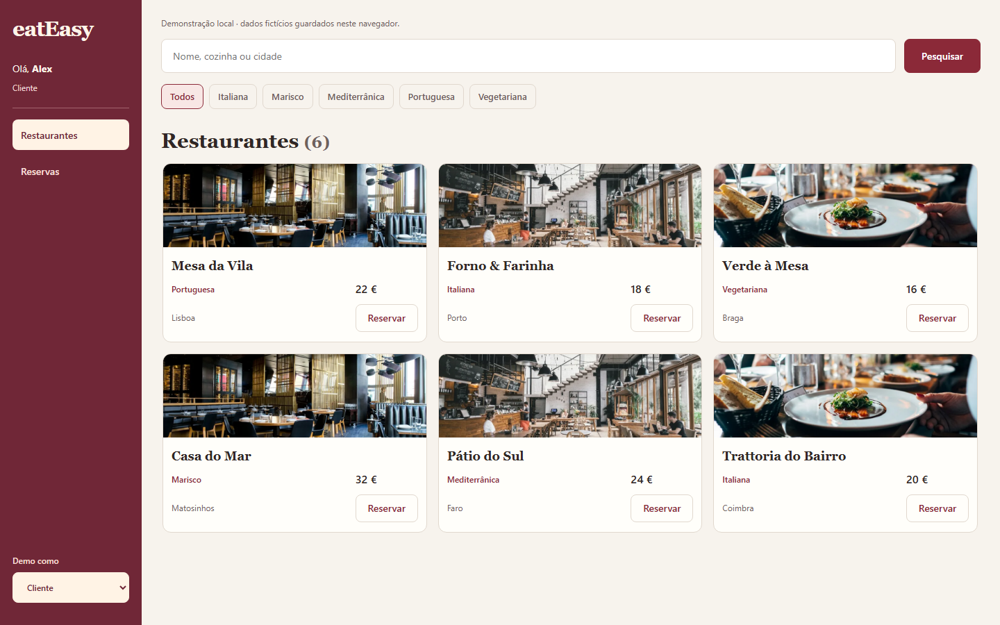

# EatEasy

A restaurant booking app with customer and admin accounts. Customers can search for a restaurant and book a table. Admins can manage restaurants and view reservations.

[Open the browser demo](https://jpndmatos.github.io/Portfolio/demo/eateasy/)



The browser demo uses fictional data stored on this device. It does not send bookings to restaurants. The original PHP application below retains its server sessions, database and customer/admin accounts.

## Features

- Customer and administrator accounts with hashed passwords.
- Restaurant search, cuisine filters, and reservation history.
- Lunch and dinner slots with checks for conflicting bookings.
- Fixed-height dashboard with scrollable restaurant lists, booking forms and reservation tables.

## Run locally

PHP 8.2+ with PDO PostgreSQL and a PostgreSQL database. Apply `database/schema-postgres.sql`, then set `EATEASY_DSN`, `EATEASY_DB_USER` and `EATEASY_DB_PASSWORD` in your server environment.

```sh
php -S localhost:8080 router.php
```

### Sample data

For a local demo, enable PDO SQLite and run:

```sh
php scripts/demo.php
EATEASY_DSN=sqlite:var/demo.sqlite EATEASY_DEMO=1 php -S localhost:8080 router.php
```

On PowerShell, set `$env:EATEASY_DSN='sqlite:var/demo.sqlite'` and `$env:EATEASY_DEMO='1'` before starting PHP. Sign in as `alex@example.test` or `admin@example.test` with `EatEasy-demo-2026`. These are local sample accounts; the script never changes a PostgreSQL database.

Screenshots use fictional sample restaurants. Demo photography: [restaurant interior](https://images.unsplash.com/photo-1517248135467-4c7edcad34c4), [dining room](https://images.unsplash.com/photo-1555396273-367ea4eb4db5), and [table service](https://images.unsplash.com/photo-1414235077428-338989a2e8c0), via Unsplash.

## Browser demo build

```sh
php -n scripts/build-demo.php
```

This creates `dist/` from the public frontend assets and `database/demo-restaurants.json`. No database contents, credentials or PHP server files are exported. The same dashboard CSS is used by both versions.
