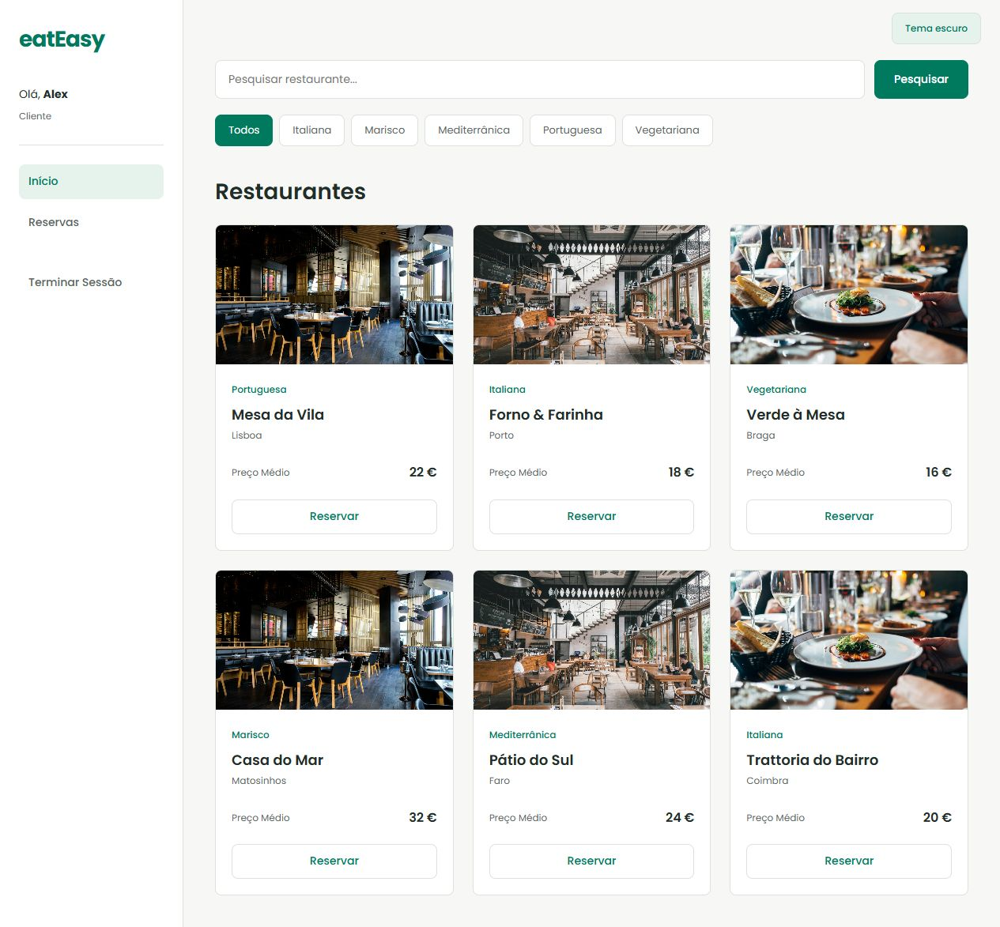
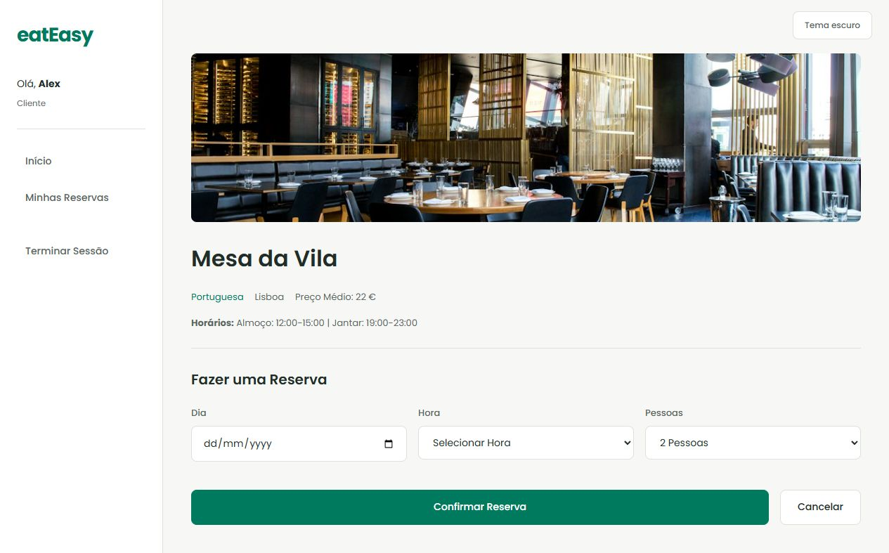
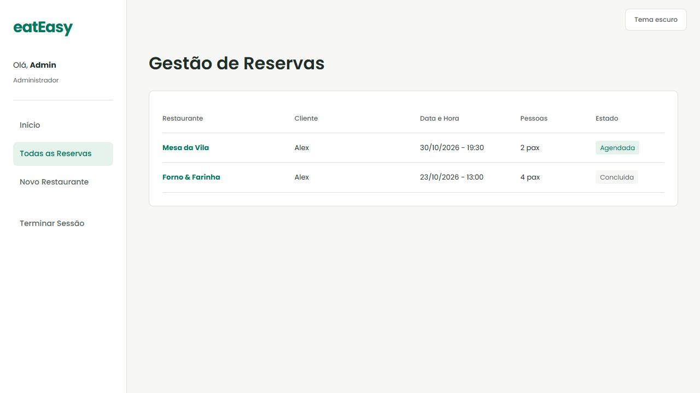
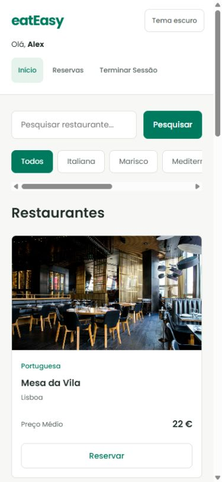

<h1><picture><source media="(prefers-color-scheme: dark)" srcset="docs/logo-dark.svg"></picture></h1>

A restaurant booking app built with PHP and PostgreSQL. Search by cuisine or location, book a table, and manage upcoming reservations. Administrators can add and edit restaurants and review bookings.

<picture>
  <source media="(prefers-color-scheme: dark)" srcset="docs/dark.jpg">
  
</picture>

<details>
<summary>Booking and mobile views</summary>
<br>



</details>

## Features

- Customer and administrator accounts with hashed passwords.
- Restaurant search, cuisine filters, and reservation history.
- Lunch and dinner slots with checks for conflicting bookings.
- Responsive layout, Poppins typography, and a saved light or dark theme.

## Run locally

PHP 8.2+ with PDO PostgreSQL and a PostgreSQL database. Apply `database/schema-postgres.sql`, then set `EATEASY_DSN`, `EATEASY_DB_USER` and `EATEASY_DB_PASSWORD` in your server environment.

```sh
php -S localhost:8080 router.php
```

### Sample data

For a local demo, enable PDO SQLite and run:

```sh
php scripts/demo.php
EATEASY_DSN=sqlite:var/demo.sqlite EATEASY_DEMO=1 php -S localhost:8080 router.php
```

On PowerShell, set `$env:EATEASY_DSN='sqlite:var/demo.sqlite'` and `$env:EATEASY_DEMO='1'` before starting PHP. Sign in as `alex@example.test` or `admin@example.test` with `EatEasy-demo-2026`. These are local sample accounts; the script never changes a PostgreSQL database.

Screenshots use fictional sample restaurants. Demo photography: [restaurant interior](https://images.unsplash.com/photo-1517248135467-4c7edcad34c4), [dining room](https://images.unsplash.com/photo-1555396273-367ea4eb4db5), and [table service](https://images.unsplash.com/photo-1414235077428-338989a2e8c0), via Unsplash. The app uses PHP, PDO, vanilla JavaScript and CSS.
